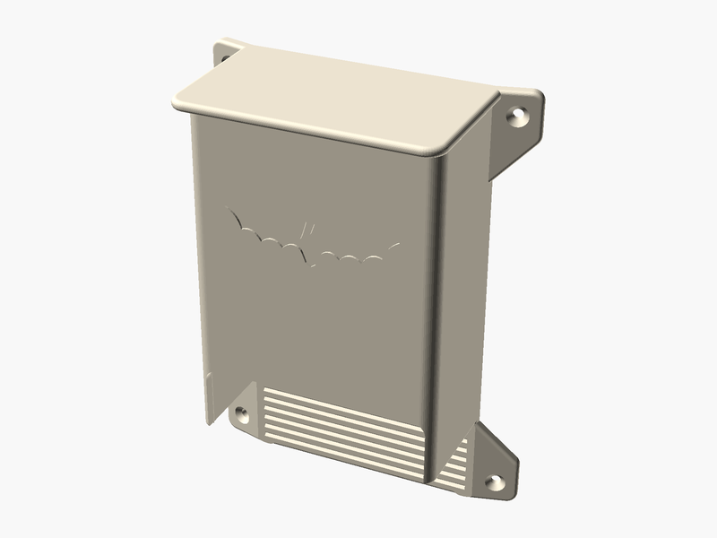

# Bat Bungalow

**Created by:** Cassiano

Bat houses are good because it helps keep the bugs/insects population down and then people do not need to use pesticide. Bat houses have a hole in the bottom that is narrow so predators or birds cant go in them. The hole also allow for waste to fall out. It helps control problematic insects without the use of pesticides.

## Printed with PHA 🌱

**What is PHA?** PHA is a plastic made by tiny microbes! They munch on plant sugars and oils and store the PHA inside their bodies, kind of like how we store energy.

**Why is it eco-friendly?** It comes from plants instead of oil. And when it's all done, it can break down back into nature (in soil, and even in the ocean) instead of hanging around for hundreds of years.

**Printing tips:**
- 🧊 **Keep it cool:** set the nozzle to about 190–200 °C.
- 💨 **Lots of air:** turn the cooling fan up high and leave the printer doors or lid open.
- 🐢 **Go a little slower:** slower prints help each layer stick and cool nicely.
- ☀️ **Keep it dry:** store the spool in a bag with a desiccant pack so it doesn't soak up water.
